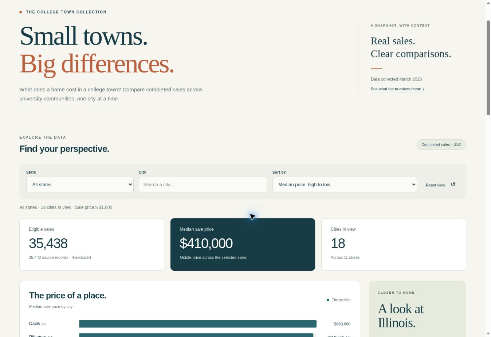

# Campus Comps — College Town Home Sales Explorer

## What this site is for

Compare completed home sales across US university communities. Students and other interested readers can compare city sale counts and typical transaction prices. The dashboard has state filtering, case-insensitive city search, four sort orders, and an Illinois shortcut. The summary cards, chart and table always use the same selected transactions.



## Live site

https://hhhhyyyyyy21035.github.io/BDI475-Hongyi.He-/

The new dashboard becomes public after the implementation pull request is merged into `main` and the existing Pages workflow succeeds. Keep this same URL in the repository About section. Until then, the public site may still show the template placeholder.

## Preview it on your own computer

From the repository folder:

```bash
python -m http.server 8000
```

Open http://localhost:8000/. Opening `index.html` directly as a file will not load the data.

The production website uses plain HTML, CSS and JavaScript. It needs no framework, package installation, server-side code, external chart library, API key or build step. All asset and data paths are relative, including under a GitHub Pages repository path.

## Data notes

- Source: `data/college_town_home_sales.csv`, version 1.0. All five original data files are unchanged.
- Eligibility: a finite `sale_price >= 1000`. The data contains **35,442 source records**, **35,438 eligible sales** and **4 excluded records**. No upper price cutoff is applied; sales above $5 million remain included.
- Records use `listing_id`, which is checked for uniqueness. Repeated street addresses are preserved. ZIP codes, FIPS codes and parcel numbers are never converted to numbers.
- Each group is a `(city, state)` pair. An eligible-sale count is the number of transactions, not the number of buildings or housing units in the city. The default view contains 18 cities across 11 states.
- The median is the middle transaction price, or the mean of the two middle prices for an even count. A filtered overall median is recalculated from all underlying eligible prices; city medians are never averaged. Half-dollar city medians are displayed with cents.
- The website uses neither the unreliable `home_type` column nor incomplete property features. It does not calculate days on market or price per square foot, so missing dates and zero living areas are not converted into misleading zero values or ratios.
- Collection date (March 2026) is not the sale-date range. Only completed sales are represented. Coverage is not a census of all sales or homes, and values are source-reported, not verified against county records. City comparisons do not adjust for size, age, timing, distance or other property differences.

### Reproduce the browser data

```bash
python scripts/summarize.py
```

This reads the CSV and writes `data/city_summary.json` under a new name. The committed JSON is about 252 KB, compared with the 9 MB CSV, and includes city-level source/excluded counts and the eligible price lists needed for exact filtered medians. Commit both the generator and its output if the source changes. This is a preparation command, **not** a Pages build step.

## How we checked our numbers

```bash
python checks/verify_summary.py
node --check assets/app.js
```

`checks/verify_summary.py` opens the original SQLite dataset read-only. Independent SQL window queries compute the median from ranked transactions, without using the CSV generator's median function or the website's JavaScript. It checks every city's count, median and entire sorted price list, global counts and the overall median, unique listing IDs, and the source CSV SHA-256 checksum.

| Number on the site | Where it appears | Independent check | Result |
|---|---|---|---|
| 35,438 eligible sales | Default summary card | SQL count using `sale_price >= 1000` | Matches |
| 4 excluded records | Default source-record note and method notes | SQL total minus eligible count | Matches |
| $410,000 overall median | Default summary card | SQL window ranks and mean of middle prices | Matches |
| 2,286 sales; $240,000 median | Champaign table row | SQL grouped ranks for Champaign, IL | Matches |
| 1,131 sales; $229,900 median | Urbana table row | SQL grouped ranks for Urbana, IL | Matches |
| 92 sales; $876,985.50 median | Pittsboro table row | SQL grouped ranks for Pittsboro, NC | Matches |

Additional browser checks by ChatGPT Codex: initial data loading; Illinois filter (3,664 sales, $245,000 median, 3 cities); case-insensitive Urbana search; no-match state; reset; ascending price and descending sale-count sorting; and a narrow phone-width iframe preview. Review of the public deployed page is still pending until the pull request is merged.

## Tools we used

GitHub Pages, plain HTML/CSS/JavaScript, and Python standard-library CSV and SQLite support. GitHub Copilot was used to read and summarize the supplied project documents. ChatGPT Codex implemented the dashboard and ran the numerical and browser checks. Details and the setup correction are recorded in `AGENT_LOG.md`. User review is pending; the checks above describe agent-performed validation, not independent checks claimed to have been performed by the student.

## Citation

College-town home sales dataset, version 1.0 (2026). University of Illinois-Deloitte Foundation Center for Business Emerging Technologies. Data collected March 2026.
